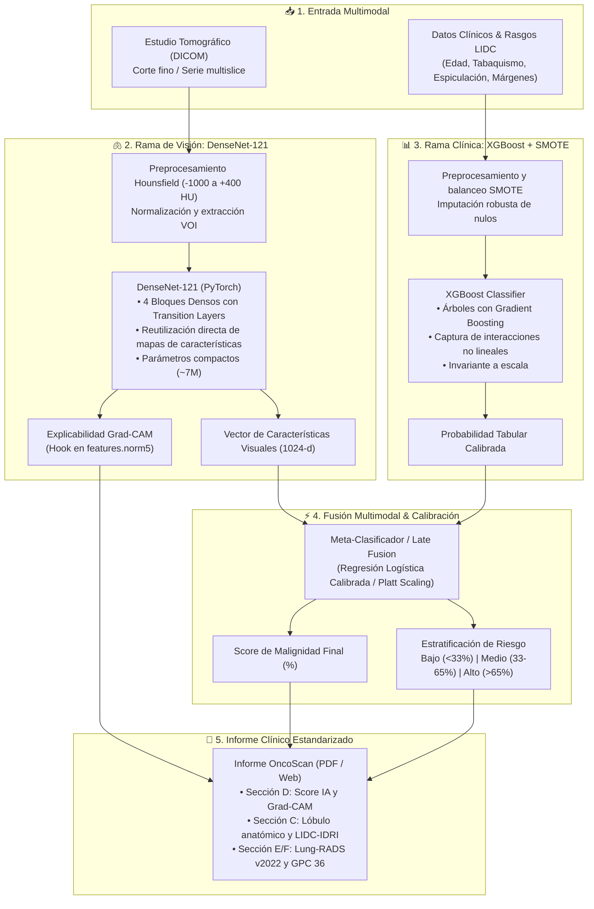
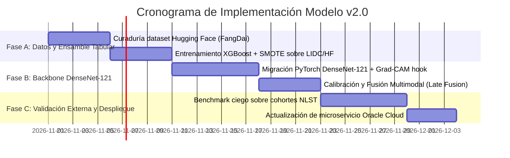

# OncoScan — Plan Estratégico de Actualización: Modelo multimodal-v2.0
## Arquitectura Híbrida (DenseNet-121 + XGBoost), Ingesta Multislice 3D y Validación Externa

> **Documento Oficial de Hoja de Ruta, Literatura Científica y Arquitectura Técnica**  
> **Versión Actual en Producción:** `multimodal-v1.2` (ResNet-18 + Clinical MLP + Grad-CAM)  
> **Próxima Generación Planificada:** `multimodal-v2.0`  
> **Fecha de Actualización:** 18 de Octubre de 2026  
> **Equipo Responsable:** Luis & Mateo (Investigación & Desarrollo OncoScan)  
> **Destinatarios:** Docente Asesor, Experto Oncólogo Evaluador y Equipo de Ingeniería

---

## 1. Fundamentación Científica y Literatura de Referencia (Estado del Arte 2026)

Con base en la auditoría del experto en cáncer y las referencias suministradas por la dirección del proyecto, la versión 2.0 de OncoScan se fundamenta en la literatura científica más reciente de 2026 en detección temprana y estratificación del riesgo oncológico pulmonar:

### 1.1 Artículo Científico de Referencia
* **Título:** *Enhancing early lung cancer detection through combined imaging and clinical data analysis* (Mejorar la detección temprana del cáncer de pulmón mediante el análisis combinado de imágenes y datos clínicos).
* **Publicación:** *European Journal of Medical Research* / Springer Nature (2026).
* **DOI:** [`10.1186/s40001-026-04307-x`](https://link.springer.com/article/10.1186/s40001-026-04307-x)
* **Aporte Metodológico:** Presenta un modelo híbrido multimodal que combina redes neuronales convolucionales densamente conectadas (**DenseNet-121**) para la extracción de características de imágenes médicas y un clasificador de ensamble (**XGBoost**) para la integración de datos clínicos demográficos y antecedentes. Demuestra que la combinación de ambas fuentes de información supera ampliamente a los modelos que operan únicamente sobre la imagen o únicamente sobre la historia clínica.
* **Técnicas de Balanceo Demostradas:**
  * **SMOTE (Synthetic Minority Over-sampling Technique):** Sobre datos clínicos tabulares para mitigar el sesgo hacia clases no malignas en entornos de tamizaje.
  * **GANs (Generative Adversarial Networks) / Aumentaciones Avanzadas:** Para expandir la diversidad de parches patológicos y radiológicos.

---

## 2. Repositorios de Datos de Referencia (Datasets Oficiales)

Para el entrenamiento, ajuste fino y validación externa independiente de la versión 2.0, se incorporan tres repositorios cardinales:

1. **`FangDai/Multimodal_Lung_Cancer_Dataset-CT-Mask-Clinical` (Hugging Face):**
   * *URL:* [huggingface.co/datasets/FangDai/Multimodal_Lung_Cancer_Dataset-CT-Mask-Clinical](https://huggingface.co/datasets/FangDai/Multimodal_Lung_Cancer_Dataset-CT-Mask-Clinical)
   * *Características:* Dataset nativo multimodal empaquetado en Hugging Face con tomografías computarizadas (CT), máscaras de segmentación binaria del nódulo y tabla de metadatos clínicos (edad, sexo, síntomas, tabaquismo y diagnóstico anatomopatológico).
   * *Rol en OncoScan:* **Dataset principal de reentrenamiento y calibración de la versión 2.0**.

2. **NLST (National Lung Screening Trial — NCI / NIH):**
   * *URL:* [cdas.cancer.gov/nlst/](https://cdas.cancer.gov/nlst/)
   * *Características:* El ensayo clínico aleatorizado de cribado pulmonar más grande y riguroso del mundo (>53.000 pacientes con TC de tórax a baja dosis y seguimiento longitudinal).
   * *Rol en OncoScan:* **Conjunto de prueba ciego de validación externa independiente (*held-out external benchmark*)** para evaluar generalización sin fuga de datos (*data leakage*). Base epidemiológica de la guía *ACR Lung-RADS*.

3. **CLID (Comprehensive Lung Cancer Imaging Dataset — Kaggle / ice778):**
   * *URL:* [kaggle.com/datasets/ice778/comprehensive-lung-cancer-imaging-dataset-clid](https://www.kaggle.com/datasets/ice778/comprehensive-lung-cancer-imaging-dataset-clid)
   * *Características:* Colección integral de tomografías computarizadas emparejadas con placas histopatológicas de confirmación.
   * *Rol en OncoScan:* Sustento de la **Sección E del informe clínico** (orientación y correlación radiopatológica conforme a la Guía GPC 36 MinSalud).

---

## 3. Arquitectura del Modelo Híbrido Multimodal v2.0

En lugar de procesar los datos clínicos con un perceptrón multicapa elemental (MLP), la versión 2.0 desacopla la extracción espacial y el razonamiento tabular antes de la fusión de decisiones:

### 3.1 Ventajas de DenseNet-121 frente a ResNet-18
* **Ecuación de flujo en DenseNet:** En cada capa $l$, la salida es:
  $$x_l = H_l([x_0, x_1, x_2, \dots, x_{l-1}])$$
  A diferencia de ResNet ($x_l = H_l(x_{l-1}) + x_{l-1}$), las conexiones densas **concatenan** los mapas de canales.
* **Impacto en nódulos pulmonares:** Los rasgos morfológicos de alta frecuencia (microespiculaciones periféricas, retracción de la pleura y patrones de calcificación punteada) extraídos en las capas iniciales no se desvanecen en la profundidad de la red, permitiendo una discriminación superior con menor número de parámetros (~7M frente a ~11.7M de ResNet-18 o ~25M de ResNet-50).

### 3.2 Ventajas de XGBoost frente a MLP para Datos Tabulares
* Los árboles de gradiente no requieren normalización forzada de rangos mixtos (como edad en años e índices discretos de 1 a 5 de LIDC-IDRI).
* Permite aislar la importancia de variables (*feature importance*) para auditar qué factor clínico pesó más en la decisión.

---

## 4. Pipeline de Ingesta Volumétrica 3D y Localización Lobar

Para automatizar la detección del lóbulo pulmonar sin depender de la selección manual previa:

1. **Ingesta Multislice:** Parser en FastAPI para descomprimir archivos `.zip` o carpetas DICOM de 150 a 300 cortes axiales continuos.
2. **Segmentación Anatómica (TotalSegmentator / nnU-Net):** Segmentación automática de los 5 lóbulos:
   * `LSD` (Lóbulo Superior Derecho)
   * `LMD` (Lóbulo Medio Derecho)
   * `LID` (Lóbulo Inferior Derecho)
   * `LSI` (Lóbulo Superior Izquierdo)
   * `LII` (Lóbulo Inferior Izquierdo)
   * `Pleura` (para determinar distancia euclidiana al margen visceral y clasificar lesiones subpleurales).
3. **Mapeo Centroide-Lóbulo:**
   $$\text{Lóbulo}(P) = \arg\max_{L \in \{\text{LSD, LMD, LID, LSI, LII}\}} \sum_{v \in \mathcal{V}(P)} \mathbb{I}(v \in \mathcal{M}_L)$$
   El centroide del nódulo detectado se cruza con las máscaras lobares y pre-llena automáticamente el informe clínico.

---

## 5. Cronograma de Implementación (Roadmap Fase 4)

---

## 6. Guion Estratégico de Presentación para la Reunión del Martes

Durante la reunión con el docente asesor y el experto oncólogo, el equipo comunicará este avance mediante la siguiente narrativa estructurada:

> *"Profesor y doctor:  
> 
> En primer lugar, agradecemos la retroalimentación de la auditoría. Implementamos de inmediato el requerimiento prioritario: el **Informe Clínico Estandarizado de OncoScan (en línea y descargable en PDF)**, estructurado con estricta separación entre el resultado computacional y la conclusión médica, localización lobar anatómica, cuantificación LIDC-IDRI y cumplimiento de las Resoluciones 1995/1999 y 3100/2019 de MinSalud, así como las directrices internacionales ACR Lung-RADS v2022 y RSNA CLAIM 2024.
> 
> Respecto al estudio de 2026 sobre **modelos híbridos multimodales** que nos compartió el profesor, valida por completo la tesis de OncoScan. Actualmente nuestra versión en producción (v1.2) opera con una línea base robusta y ligera (ResNet-18 + Clinical MLP) con sensibilidad $\ge 91.6\%$ y explicabilidad Grad-CAM en tiempo real.
> 
> Como hoja de ruta formal hacia la versión **`multimodal-v2.0`**, ya tenemos formulada la arquitectura híbrida que adopta **DenseNet-121** en la rama de visión —para maximizar la reutilización de características sutiles como espiculaciones y vidrio esmerilado— junto con **XGBoost y balanceo SMOTE** para las variables clínicas y antecedentes, reentrenando sobre el dataset multimodal de Hugging Face (`FangDai`) y reservando el repositorio del **NLST (National Lung Screening Trial)** para la validación externa independiente.
> 
> Gracias al desacoplamiento de nuestra plataforma mediante microservicios, esta actualización de la IA se integrará de forma nativa sin generar ninguna fricción ni alterar la experiencia de los médicos usuarios."*
