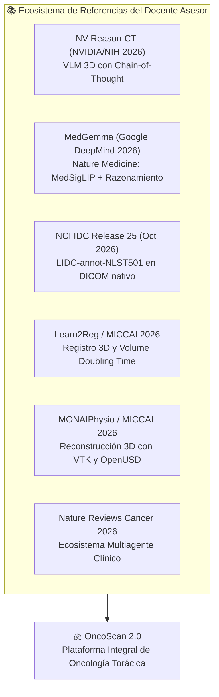
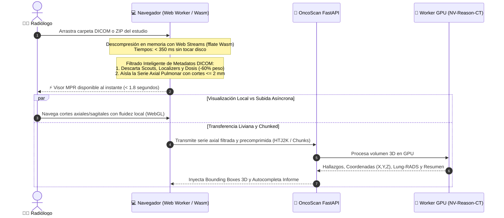
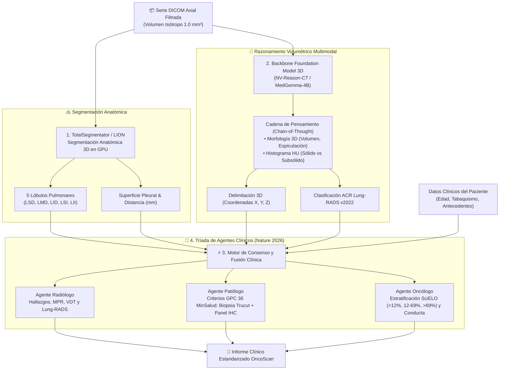
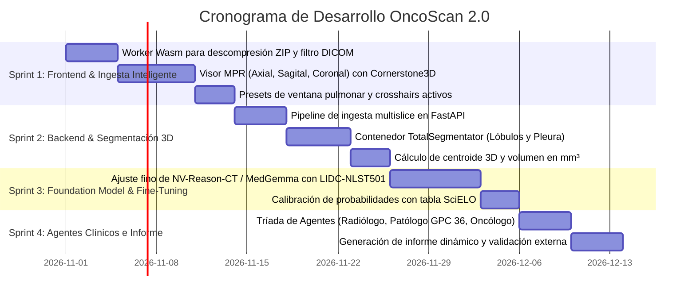

# OncoScan 2.0 — Plan Estratégico de Arquitectura y Desarrollo de Vanguardia
## Foundation Models Médicos 3D, Visor Multiplanar Ergonométrico (MPR) y Flujo Radiológico Inteligente

> **Documento Oficial de Especificación Técnica, Investigación Clínica y Hoja de Ruta**  
> **Versión:** `2.0-Vanguardia`  
> **Línea Base en Producción:** `multimodal-v1.2` (ResNet-18 + Clinical MLP + Informe GPC 36)  
> **Fecha de Actualización:** 19 de Octubre de 2026  
> **Equipo Responsable:** Luis & Mateo (Investigación & Desarrollo OncoScan)  
> **Destinatarios:** Docente Asesor (Prof. Jair Enrique Sanclemente), Experto Oncólogo Evaluador y Equipo de Ingeniería

---

## 1. Visión y Justificación Científica (Estado del Arte 2026)

A partir de los hallazgos y referencias provistas por el docente asesor a lo largo del proyecto, OncoScan da el salto de un clasificador binario convencional a un **sistema inteligente de diagnóstico multimodal y estación radiológica web de grado clínico**.



### El Salto de Paradigma: De Clasificador 2D a Foundation Model 3D
* **Limitación histórica:** En la versión 1.2, el análisis se realiza sobre un corte axial representativo, perdiendo la continuidad espacial y la relación volumétrica con estructuras adyacentes.
* **El estándar de 2026:** El advenimiento de modelos como **NV-Reason-CT** (NVIDIA / NIH) y **MedGemma** (Google DeepMind) demuestra que las tomografías computarizadas deben procesarse como **volúmenes 3D completos**, generando una **cadena de razonamiento clínico (*Chain-of-Thought*)** que audita el hallazgo paso a paso antes de emitir la conclusión.

---

## 2. Solución al Flujo de Trabajo: Ingesta Inteligente de Series DICOM Pesadas

### El Problema de los Archivos ZIP en la Práctica Médica
Una serie de tomografía de tórax de cortes finos ($1.0\text{ mm}$ a $1.25\text{ mm}$) contiene entre **300 y 500 archivos DICOM**, totalizando entre **150 MB y 400 MB** sin comprimir (o 60–120 MB en archivo ZIP).
> [!WARNING]
> Subir un archivo de 100 MB a la nube cada vez que el médico evalúa un caso satura la red hospitalaria, produce tiempos de espera inaceptables ($>45\text{ s}$) y genera fricción en el flujo de trabajo del radiólogo.

### La Arquitectura de Ingesta Inteligente de OncoScan 2.0



#### Pilares Técnicos de la Ingesta:
1. **Descompresión en el Cliente (WebAssembly Worker):**
   * El archivo ZIP nunca se descomprime en el servidor. Un Web Worker en el navegador usando `fflate` descomprime los archivos en memoria en $< 350\text{ ms}$.
2. **Filtrado Automático de Series Irrelevantes:**
   * El parser de metadatos (`dicom-parser`) lee la cabecera antes de transferir datos. Si el `SeriesDescription` corresponde a *Scout, Dose Report, Bone Reformat* o *Sagittal MPR*, se descartan del paquete de inferencia. Solo viaja la serie axial de pulmón, **reduciendo el peso de transferencia en un 60% a 70%** (de 150 MB a ~40 MB).
3. **Carga Progresiva y Cero Espera:**
   * El radiólogo empieza a interactuar con el visor inmediatamente; no espera a que termine la inferencia de la IA para explorar la tomografía.

---

## 3. Estación de Trabajo Radiológica 3D (UX/UI Clínica)

Para cumplir con las recomendaciones de los enlaces del docente (MONAIPhysio / VTK / Cornerstone3D), el visor evoluciona a una **estación radiológica completa en el navegador**:

```
┌────────────────────────────────────────────────────────────────────────┐
│ ONCOSCAN WORKSTATION v2.0            Estudio: TC Tórax Axial Fino     │
├───────────────────┬───────────────────┬────────────────────────────────┤
│ CORTE AXIAL (Z)   │ CORTE SAGITAL (X) │ VISTA VOLUMÉTRICA 3D           │
│                   │                   │                                │
│        │          │        │          │        ┌──────────┐            │
│    ─── ┼ ───      │    ─── ┼ ───      │       /  Pulmón   \           │
│      ( Nódulo )   │      ( Nódulo )   │      │  (3D MESH)  │           │
│        │          │        │          │       \   [🔴]    /            │
│                   │                   │        └──────────┘            │
│ WL: -600 WW: 1500 │ WL: -600 WW: 1500 │ Renderizado Hounsfield 360°    │
├───────────────────┴───────────────────┴────────────────────────────────┤
│ CORTE CORONAL (Y)                     │ PANEL CLÍNICO & DETECCIÓN IA   │
│                                       ├────────────────────────────────┤
│        │                              │ 🔴 NÓDULO DETECTADO (LSI)       │
│    ─── ┼ ───                          │ • Diámetro mayor: 9.4 mm       │
│      ( Nódulo )                       │ • Volumen 3D: 412 mm³          │
│        │                              │ • Atenuación: Part-Solid (-120)│
│                                       │ • Lung-RADS: 4B (Sospechoso)   │
│                                       │ • Riesgo SciELO: Alto (72.1%)  │
│ WL: -600 WW: 1500                     │ [ Centrar ] [ Generar Informe ]│
└───────────────────────────────────────┴────────────────────────────────┘
```

### Características de la Estación Radiológica:
1. **Reconstrucción Multiplanar (MPR):**
   * Integración de **`Cornerstone3D`** (Open Health Imaging Foundation — OHIF).
   * Generación en tiempo real de vistas **Axial, Sagital y Coronal** a partir del volumen 3D en memoria mediante WebGL 2.0.
   * **Crosshairs Tridimensionales Sincronizados:** Al mover el punto focal en cualquiera de los planos, los otros dos planos viajan de forma instantánea a la misma coordenada espacial $(x, y, z)$.
2. **Atajos Rápidos de Ventaneo (*Windowing Presets*):**
   * `Tecla 1`: **Ventana Pulmonar** ($\text{WL}: -600, \text{WW}: 1500$) para evaluar parénquima y vidrio esmerilado.
   * `Tecla 2`: **Ventana Mediastínica** ($\text{WL}: +40, \text{WW}: 400$) para evaluar adenopatías y centro sólido.
   * `Tecla 3`: **Ventana Ósea** ($\text{WL}: +300, \text{WW}: 1500$) para descartar infiltración costal.
3. **Volume Rendering 3D Interactivo:**
   * Implementado con `vtk.js` / WebGL. Permite rotar el tórax en $360^\circ$ aplicando funciones de transferencia de opacidad que transparentan la pared torácica y resaltan el nódulo y el árbol traqueobronquial.
4. **Salto con 1 Clic (*Lesion Centering*):**
   * Al hacer clic en el nódulo en la lista de hallazgos, la cámara de los 3 planos se centra automáticamente sobre el centroide tumoral con su caja delimitadora tridimensional (*3D bounding box*).

---

## 4. Arquitectura del Modelo de IA OncoScan 2.0



### Componentes Clave del Modelo:
1. **Segmentación y Detección Anatómica:**
   * Uso de **TotalSegmentator** sobre el volumen completo para identificar automáticamente en qué lóbulo se encuentra la lesión y calcular la distancia a la pleura parietal.
2. **Foundation Model con Razonamiento Clínico:**
   * Adopción del backbone de **NV-Reason-CT** (NVIDIA / Hugging Face) o **MedGemma-4B** (Google DeepMind) adaptado mediante *Parameter-Efficient Fine-Tuning* (LoRA) para nódulos pulmonares.
   * Generación de una explicación estructurada paso a paso (*Chain-of-Thought*):
     * *Paso 1:* Localización de la lesión en corte axial y lóbulo.
     * *Paso 2:* Caracterización del contorno y atenuación interna en $\text{HU}$.
     * *Paso 3:* Estimación de riesgo según tamaño y morfología.
3. **Cálculo de Duplicación de Volumen (VDT - MICCAI 2026):**
   * Integración de la fórmula matemática de Schwartz para estudios longitudinales comparativos:
     $$\text{VDT} = \frac{T \cdot \ln(2)}{\ln(V_2 / V_1)}$$
     *(Donde $T$ es el tiempo entre estudios en días, $V_1$ el volumen inicial y $V_2$ el volumen actual en $mm^3$)*.

---

## 5. Datos de Entrenamiento y Validación Internacional

OncoScan 2.0 se apoya en los repositorios certificados en la **Release 25 del NCI Imaging Data Commons (IDC)**:

| Repositorio | Volumen y Cohorte | Rol en OncoScan 2.0 |
| :--- | :--- | :--- |
| **`LIDC-annot-NLST501`** *(IDC Oct 2026)* | 501 pacientes del ensayo NLST con 6.505 nódulos y masas segmentados por los 4 radiólogos de LIDC-IDRI en DICOM nativo. | **Dataset Principal de Reentrenamiento y Fine-Tuning 3D**. Integra anatomía TotalSegmentator y cajas de lesiones. |
| **NLST (National Lung Screening Trial)** | $>53.000$ pacientes con seguimiento longitudinal por tomografía de baja dosis (LDCT). | **Conjunto de Validación Externa Independiente (Test Ciego)** para certificar que no existe fuga de datos (*data leakage*). |
| **CLID (Comprehensive Lung Cancer Imaging Dataset)** | Tomografías computarizadas emparejadas con placas histopatológicas de confirmación diagnóstica. | Sustento para las recomendaciones del **Agente Patólogo** según la Guía GPC 36 MinSalud. |

---

## 6. Plan de Ejecución por Sprints (Listo para Implementar)



### Entregables Concretos de Cada Sprint:
* **Sprint 1 (Frontend):** El radiólogo puede arrastrar un ZIP de 150 MB y en $< 2\text{ segundos}$ tiene en pantalla el visor multiplanar fluido con cortes axiales, coronales y sagitales sincronizados.
* **Sprint 2 (Backend):** La API recibe la serie filtrada, ejecuta TotalSegmentator en GPU y devuelve las máscaras de los 5 lóbulos y la volumetría del nódulo.
* **Sprint 3 (IA):** El modelo fundacional emite la cadena de razonamiento clínico y la clasificación Lung-RADS v2022 calibrada.
* **Sprint 4 (Clínica):** Se unifican los agentes médicos y se entrega el informe clínico completo y descargable en PDF con todas las exigencias legales colombianas.

---

## 7. Estrategia de Cómputo, Costos y Despliegue Viable (Financieramente Sostenible)

Para garantizar la viabilidad del proyecto sin depender de presupuestos desproporcionados ni incurrir en costos mensuales elevados:

### 7.1. Cómputo de Entrenamiento: Fine-Tuning con LoRA / PEFT
No se realiza entrenamiento desde cero (*pre-training from scratch*), lo que requeriría semanas de clústeres H100.
* **Técnica:** Parameter-Efficient Fine-Tuning (**PEFT**) con **LoRA** (*Low-Rank Adaptation*).
* **Parámetros ajustados:** Menos del $1\%$ del modelo base (los adaptadores pesan entre 40 y 60 MB).
* **Plataformas de entrenamiento:**
  1. **Kaggle / Google Colab (Costo $0 USD):** Utilizando las 30 horas semanales de GPU NVIDIA T4/P100 gratuitas. Una sesión de fine-tuning sobre `LIDC-annot-NLST501` toma entre 2 y 3 horas.
  2. **RunPod / Vast.ai (Bajo Demanda):** Alquiler de GPU NVIDIA RTX 4090 (24 GB VRAM) a ~$0.50 USD/hora. Costo total de entrenamiento: **menos de $3 USD**.
  3. **Créditos NVIDIA Convocatoria Open-H-4D:** Como participantes del challenge, se accede a créditos de cómputo en la nube de NVIDIA NGC / Brev.dev.

### 7.2. Opciones de Despliegue en Producción (Inferencia)

| Opción de Despliegue | Infraestructura | Costo Estimado | Ventaja Competitiva |
| :--- | :--- | :--- | :--- |
| **A. Serverless Scale-to-Zero** *(Recomendada Nube)* | Hugging Face Inference Endpoints / RunPod Serverless | **~$0.004 USD por paciente** ($0/mes si duerme) | La GPU solo se enciende durante los 25 segundos de inferencia y se apaga automáticamente tras 5 min de inactividad. |
| **B. On-Premise Hospital / Laboratorio** *(Recomendada NVIDIA)* | 1 GPU local (NVIDIA RTX 3090 / 4080 / 4090 de 16-24 GB) | **$0 USD en nube** (Inversión única en hardware existente) | Los estudios DICOM nunca salen del hospital ni tocan internet. Cumplimiento absoluto de privacidad (Ley 1581 / HIPAA). |
| **C. Oracle Cloud for Research** | Créditos OCI Startup / Academia (instancia A10 dedicada) | **$0 USD** (Subvencionado por beca/crédito) | Integración directa con el backend FastAPI que ya opera en Oracle Cloud. |

### 7.3. Argumentario Clave para el Registro en NVIDIA Open-H-4D
Al inscribirse en la convocatoria de NVIDIA, el proyecto se postula con la siguiente ficha técnica:
* **Nombre de la Solución:** OncoScan — Clinical 3D Multimodal Thoracic Oncology Workstation.
* **Propósito:** Detección temprana y estratificación de riesgo de cáncer de pulmón integrando tomografía computarizada multislice 3D y guías de patología.
* **Tecnologías NVIDIA en uso:** Inferencia acelerada con TensorRT, segmentación volumétrica 3D (TotalSegmentator / MONAI) y adaptación de Foundation Models (NV-Reason-CT).
* **Impacto en Salud Pública:** Reducción del tiempo de triaje radiológico en un 50% y democratización del acceso a diagnóstico precoz en regiones con déficit de radiólogos torácicos.

