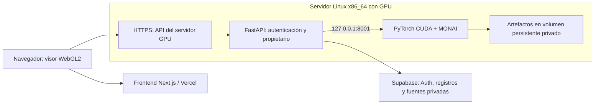

# Producción del flujo volumétrico de OncoScan

**Propuesta técnica del 22 de octubre de 2026. No desplegada ni probada en un servidor Linux en esta sesión.** Leer primero [la entrega](../HANDOFF-2026-10-22.md).

## 1. Qué cambia al salir del PC

La GTX 1650 ejecuta las redes únicamente en el entorno de desarrollo. En producción, esos mismos modelos y pesos pueden ejecutarse en una GPU del servidor. El navegador de cada usuario sigue dibujando con Three.js/WebGL2 en su propio dispositivo; no requiere instalar CUDA ni tener una tarjeta NVIDIA.

La TC y los resultados se procesan una vez y se reutilizan mientras coincidan datos, variables, pesos y versiones del pipeline. Girar el pulmón, cambiar opacidad o recortar no ejecuta MONAI de nuevo ni requiere mantener una GPU dedicada por usuario. Sí hay que dimensionar la inferencia según estudios nuevos, tamaño y concurrencia.

No hace falta reentrenar por cambiar de GTX 1650 a una GPU de servidor. Sí hacen falta instalación compatible, comprobación de pesos, prueba de equivalencia funcional y benchmark de destino.

## 2. Ruta inicial recomendada: API e IA en un mismo servidor GPU

Es la adaptación menor al código actual. Mantiene `LOCAL_ML_URL` en loopback sin abrir el worker al público.



La documentación histórica sitúa la API del MVP en Render y la inferencia 2D en Oracle ARM. Esta propuesta mueve la API del nuevo flujo al servidor GPU, o exige separar claramente las responsabilidades entre las dos APIs. No se han inspeccionado recursos activos de esas cuentas ni se afirma que el servidor Oracle actual disponga de GPU.

**Importante:** `volume.py:local_ml_base()` acepta solamente `localhost`, `127.0.0.1` o `::1`. Una URL remota en `LOCAL_ML_URL` devuelve 503. API y worker deben compartir máquina y espacio de red; dos contenedores separados con redes por defecto no comparten loopback. Para el primer staging se pueden usar dos procesos supervisados en la misma VM. Una alternativa con contenedores requiere diseñar explícitamente la red; no basta con escribir `http://ml:8001` en la variable.

### Capacidad inicial para medir

Propuesta de partida, **no mínimo clínico ni capacidad garantizada**: Linux x86_64, una GPU NVIDIA con 16 GB de VRAM, 8 vCPU, 32 GiB de RAM y disco persistente dimensionado por retención. Ejemplo verificable de esa combinación: AWS `g4dn.2xlarge`, T4 16 GiB, 8 vCPU y 32 GiB RAM. Es una referencia de hardware; no se contrató ni se afirma que sea la opción más barata. [Especificaciones oficiales EC2](https://docs.aws.amazon.com/ec2/latest/instancetypes/ac.html).

El código está ajustado para la GTX 1650 de 4 GB: ventanas 96³, precisión mixta y acumulación CPU. Esos ajustes se conservan primero en staging; después se optimizan con mediciones. No aumentar automáticamente ventanas o número de workers por disponer de más VRAM.

CPU tiene una ruta prevista en el código, pero no se midió la latencia ni el consumo para el volumen completo en un servidor CPU. No asumir que Oracle ARM gratuito o una instancia pequeña sustituyen al worker GPU con el mismo tiempo de respuesta.

### Componentes operativos que faltan

1. Crear un paquete versionado de código y pesos; registrar SHA-256 y permisos/licencias de los artefactos. Los `.pth` de OncoScan no están en Git.
2. Crear y probar los entornos Linux, corrigiendo el manifiesto de dependencias API y los lockfiles de web.
3. Supervisar API y worker con servicios del sistema o un empaquetado de contenedores probado. No usar `--reload` ni el script PowerShell de desarrollo.
4. Publicar solo la API detrás de HTTPS. Mantener 8001 privado; no exponer su Swagger, `/predict`, `/volumes` o artefactos directamente.
5. Añadir persistencia de jobs/cola, política de reintento/reconciliación, almacenamiento privado persistente y limpieza de derivados.
6. Montar observabilidad de cola, errores, tiempos, RAM/VRAM y disco; separar salud del proceso, readiness de modelos y disponibilidad de GPU.
7. Ejecutar las pruebas de staging de la sección 6 antes de cambiar el frontend público.

Si se elige Docker, instalar driver NVIDIA y NVIDIA Container Toolkit conforme a la documentación oficial. La imagen debe incluir las dependencias CUDA de PyTorch compatibles con ese driver. No hay Dockerfile o imagen GPU comprobada en esta entrega. [Guía oficial NVIDIA](https://docs.nvidia.com/datacenter/cloud-native/container-toolkit/latest/install-guide.html).

### Comandos de procesos como referencia

Estos comandos se ejecutan desde `apps/api` en la VM de staging, **después** de preparar los entornos y secretos; son una referencia para los servicios supervisados, no un despliegue probado. Se propone Python 3.11 también para API en Linux para alinearlo con los paquetes fijados.

```bash
.venv-ml/bin/python -m uvicorn local_ml_server:app --host 127.0.0.1 --port 8001 --workers 1
```

En otro proceso supervisado:

```bash
.venv/bin/python -m uvicorn app.main:app --host 127.0.0.1 --port 8000 --workers 1
```

El proxy HTTPS enruta hacia la API en 8000. Un proceso ML por GPU evita duplicar modelos y la cola en memoria. La cola actual es un `ThreadPoolExecutor(max_workers=1)` con hasta cuatro jobs queued/processing; **no es una cola durable ni un scheduler distribuido**. Escalar réplicas requiere rediseñar ese estado.

## 3. Variables de entorno

Solo se documentan nombres y valores de ejemplo sin secretos.

| Contexto | Variable | Valor/acción en la topología recomendada |
| --- | --- | --- |
| API | `HF_API_BASE_URL` | `http://127.0.0.1:8001`, para que análisis 2D/volumen no use por defecto el servidor histórico. |
| API | `LOCAL_ML_URL` | `http://127.0.0.1:8001`, para el nuevo flujo 3D. |
| API | `HF_PREDICT_TIMEOUT` | Punto de partida 120 s; ajustar tras benchmark, no usarlo como timeout de todo el job volumétrico. |
| API | `SUPABASE_URL` | Proyecto de staging/producción elegido por el equipo. |
| API | `SUPABASE_SERVICE_ROLE_KEY` | Secreto solo servidor, gestionado por el responsable de infraestructura. |
| API | `SUPABASE_BUCKET_NAME` | Bucket privado configurado; verificar permisos y retención. |
| API | `ANONYMIZATION_SALT` | Secreto propio de entorno; evitar depender del fallback del código. |
| API | `LOG_LEVEL` | Nivel operativo sin registrar datos de pacientes. |
| Frontend | `NEXT_PUBLIC_API_URL` | URL **HTTPS pública de la API**; nunca `localhost` en un build de producción. |
| Frontend servidor | `API_URL` | Misma API HTTPS para server actions existentes. |
| Frontend | `NEXT_PUBLIC_SUPABASE_URL` | Proyecto de Supabase correspondiente. |
| Frontend | `NEXT_PUBLIC_SUPABASE_PUBLISHABLE_KEY` | Clave pública del proyecto, nunca `service_role`. |

Revisar CORS de `app/main.py`, orígenes Preview/Production y URLs de redirección de Auth. Las variables `NEXT_PUBLIC_*` se incorporan al build: cambiar la URL exige reconstruir/republicar frontend. No se cambiaron secretos o proyectos remotos en esta sesión.

Las rutas de fuentes y modelos están actualmente ligadas al árbol del repo: preservar `docs/modelo-v2-densenet/entrenamiento_e_inferencia_v2.py`, `docs/modelo-v2-densenet/weights/` y `apps/api/.cache/models/`. Si se convierten en variables configurables, añadir pruebas y documentación del nuevo contrato. La imagen o volumen debe proporcionar esos archivos antes de aceptar jobs; `/health` actual no prueba por sí solo que todos los pesos existan.

## 4. Alternativa: conservar API en Render y usar worker GPU separado

Es viable como arquitectura futura, pero requiere implementar lo siguiente:

- Sustituir el guard de loopback por un modo de producción explícito con host allowlist, TLS y autenticación servicio a servicio; conservar el modo local actual.
- Proteger también el lado worker. Las cabeceras Bearer de los usuarios las valida la API; hoy el worker no las valida y confía en loopback.
- Pasar al worker referencias autorizadas de almacenamiento y versión de estudio, en lugar de reenviar el volumen entero en cada consulta de preparación.
- Persistir jobs y artefactos para que réplicas y reinicios encuentren el mismo estado; decidir si la cola es Redis, una tabla transaccional u otro servicio, con leases y reintentos definidos.
- Evitar exponer el worker o URLs de estudios privadas desde el navegador; mantener comprobaciones de propietario y vínculo job–estudio en todos los accesos.
- Medir límites de subida, RAM, egress, timeouts y costes entre proveedores/regiones. El endpoint actual `/prepare` descarga y reenvía todo el archivo incluso si el resultado ya está cacheado.

Esta alternativa no se habilita únicamente cambiando variables. No eliminar la restricción local sin implementar el contrato de confianza completo.

## 5. Almacenamiento, coste y límites que cambian el diseño

**Persistencia:** los resultados completados se reconocen por `manifest.json` en disco. El estado de trabajos en curso está en memoria y se pierde al reiniciar. Un volumen persistente conserva resultados terminados, pero no recupera por sí solo jobs interrumpidos. Es necesario registrar estados, versión, propietario, timestamps, heartbeat/lease e intento; recuperar o marcar fallo de ejecuciones huérfanas. Guardar los derivados privados por estudio y definir retención/borrado en cascada.

**Render Free:** no es el destino propuesto para inferencia volumétrica. Su disco es efímero, los reinicios pierden cambios locales y el propio proveedor desaconseja ese plan para producción. No trasladar allí `.cache` suponiendo que es almacenamiento persistente. [Límites oficiales de Render Free](https://render.com/docs/free).

**Vercel:** mantenerlo para la web. Las Vercel Functions tienen límite documentado de 4,5 MB por request/response; esta muestra ya produce un atlas anatómico de unos 8,9 MB. La carga de series y la descarga de atlas privados deben ir directamente a API/almacenamiento autorizado, no atravesar una Server Action como transporte binario. El límite de funciones no es un límite de WebGL ni de los assets estáticos. [Límites oficiales de Vercel Functions](https://vercel.com/docs/functions/limitations).

**Coste:** presupuestar horas de servidor GPU + disco persistente + almacenamiento/DB + egress + observabilidad. No hay tarifa ni coste mensual cerrado en esta entrega. GPU siempre encendida paga horas ociosas; GPU bajo demanda ahorra ociosidad a cambio de arranque y cola. Elegir tras medir volumen diario y objetivo de latencia. Sin gasto externo contratado hoy.

**Privacidad:** no hay modo de cero retención demostrado por este pipeline: escribe máscaras y artefactos en disco. No anunciarlo como tal. Los hashes de estudio no son un sustituto del control de acceso. Definir qué se borra, cuándo, quién tiene acceso y qué permanece en backups/logs.

## 6. Aceptación de staging antes de publicar

| Comprobación | Condición de aceptación |
| --- | --- |
| Revisión entregada | Código y dependencias identificados; pesos verificados y disponibles sin carpetas personales del desarrollador. |
| Arranque en frío | Reiniciar la VM; procesos recuperan estado, modelos verifican disponibilidad y GPU se usa efectivamente. |
| Independencia del PC | Apagar los servicios del PC original; desde otro equipo se completa carga, análisis y visor 3D en staging. |
| Fuente pública | TCChest completa produce geometría esperada, cinco etiquetas y tres atlas alineados; revisar coronal/axial, no solo presencia de etiquetas. |
| E2E autenticado | Dos usuarios de staging; cada uno ve solo sus estudios, jobs y tres artefactos. |
| URL pública | Bundle del navegador no contiene loopback para la API productiva; HTTPS, CORS y sesión funcionan. |
| Reinicio durante job | Ningún estudio queda perdido o `processing` indefinidamente; reanudación o fallo recuperable registrado. |
| Concurrencia | Medir uno y después varios estudios; sin OOM, bloqueo del API ni doble ejecución no controlada; backpressure verificable. |
| Entradas inválidas | Series mezcladas, espaciado irregular, volumen vacío, ZIP sobredimensionado y formatos no soportados generan rechazo controlado. |
| Artefactos | No se pierden al redeploy; rutas privadas mantienen propietario y cabeceras; borrado elimina derivados según política. |
| Presupuesto de latencia | Registrar cola, descarga, lectura, MONAI, CAM, generación y transferencia por separado; acordar p50/p95 después de medir. |
| Navegadores | WebGL2 y memoria/texturas verificadas en dispositivos objetivo; fallo explícito si no hay soporte. |
| Regresión | Suites frontend/backend y build pasan en Linux; documentar diferencias frente a Windows. |
| Operación | Alarmas, logs sin datos sensibles, responsables, límites de gasto, backups y procedimiento de rollback ensayados. |

Para retirarlo o volver atrás: drenar/admitir cero jobs nuevos, registrar el estado pendiente, conservar código/pesos y referencias de artefactos de la revisión anterior, revertir web/API/worker de forma coordinada y verificar que los caches se distinguen por versión. No borrar fuentes o modelos durante un rollback. La implementación de ese procedimiento y su ensayo siguen pendientes.

Publicar una aplicación operativa no acredita desempeño médico. Si se busca uso clínico, el protocolo de validación independiente y la revisión correspondiente son un frente separado de la infraestructura.
