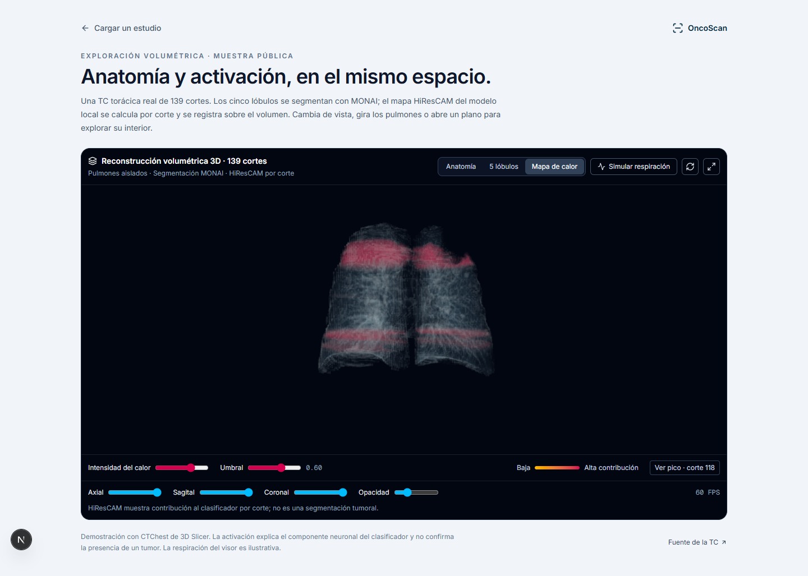
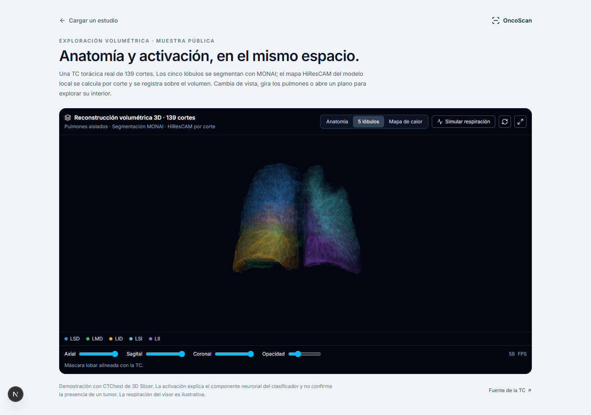

# Volumen pulmonar, segmentación MONAI y HiResCAM local

Implementación y comprobación: 22 de octubre de 2026.

Para continuar el trabajo: [entrega al compañero](../HANDOFF-2026-10-22.md), [ruta a producción](PRODUCCION.md) e [inventario de la entrega](handoff-2026-10-22/run-manifest.json). El estado actual está probado localmente; falta reproducción independiente y despliegue del nuevo flujo.

## Abrir y arrancar

**Muestra real sin inicio de sesión:** http://localhost:3000/demo/pulmon-3d

Desde la raíz del repositorio:

```powershell
powershell -ExecutionPolicy Bypass -File scripts/start_local_services.ps1
```

El script arranca los servicios que faltan, en ventanas ocultas, y conserva los procesos que ya escuchan. Logs: `apps/api/.cache/service-logs/`.

| Servicio | Dirección | Entorno |
| --- | --- | --- |
| Next.js | http://localhost:3000 | Node, React, Three.js |
| API | http://127.0.0.1:8000 | `apps/api/.venv`, Python 3.14 |
| Inferencia y volúmenes | http://127.0.0.1:8001 | `apps/api/.venv-ml`, Python 3.11 |

La inferencia corre en esta máquina. El flujo de estudios conserva la configuración existente de Supabase para identidad, registros y Storage; eso no equivale a disponer de una base de datos completamente desconectada. La muestra pública del visor utiliza solamente archivos locales.

## Qué funciona

- Reconstrucción de una TC real de 139 cortes con trama vascular, iluminación por gradiente, proporciones físicas y ventana pulmonar −600/1500 HU.
- Segmentación neuronal de los cinco lóbulos con MONAI SegResNet y etiquetas enteras, sin fronteras lobares dibujadas mediante condiciones geométricas.
- HiResCAM calculado mediante autograd sobre cada corte con soporte pulmonar, situado en la misma rejilla que la TC y las etiquetas.
- Modos Anatomía, 5 lóbulos y Mapa de calor; umbral e intensidad del calor, rotación, zoom, opacidad, recortes axial/sagital/coronal, pantalla completa y disposición móvil.
- El botón «Ver pico» usa las coordenadas del máximo del volumen de activación. Se identifica expresamente como activación, no como nódulo detectado.
- Integración en `StudyViewerTabs`: prepara el volumen del estudio con progreso y descarga los tres atlas mediante endpoints protegidos. Un corte aislado no se convierte artificialmente en anatomía 3D.
- Errores de preparación, autenticación y WebGL visibles; no hay sustitución por un pulmón procedural al fallar una descarga.





## Tecnologías del plan y responsabilidades

| Tecnología | Uso efectivo |
| --- | --- |
| Three.js / WebGL2 | Raymarching interactivo del volumen dentro del navegador. |
| PyTorch / torchvision / CUDA | Inferencia real de DenseNet multimodal, codificadores ResNet y CLID; gradientes para HiResCAM. |
| MONAI | Inferencia 3D de segmentación lobar, ventana deslizante e inversión de la geometría del preprocesamiento. |
| XGBoost | Cabezal del ensemble usando `Booster` nativo y el checkpoint existente. |
| pydicom / NiBabel / SciPy | Lectura, orden espacial, orientación canónica y remuestreo de TC y etiquetas. |
| MONAI Physio / NVIDIA Omniverse | No integrados. Son una posible ampliación para movimiento y fisiología, escenas USD y visualización RTX. |

WebGL2 y CUDA tienen funciones distintas: el primero dibuja la interfaz web y el segundo ejecuta las redes en el servidor local. MONAI ya se utiliza junto a ambos. Three.js requiere WebGL2 desde r163: [WebGLRenderer](https://threejs.org/docs/pages/WebGLRenderer.html).

[MONAI Physio](https://project-monai.github.io/monai-physio/) ofrece flujos de gemelos fisiológicos, movimiento predicho desde TC y exportación OpenUSD para Omniverse. Su incorporación requiere otro contrato de datos y evaluación del movimiento. La animación respiratoria actual sigue siendo ilustrativa y está apagada inicialmente; no mide excursión diafragmática del paciente.

El repositorio actual usa Next.js 16 y React 19, aunque el texto del plan mencionaba Next.js 14 y React 18. La API permanece en Python 3.14; se aisló ML en Python 3.11 para instalar las versiones compatibles de PyTorch/CUDA/MONAI. La fase 3 ha avanzado con segmentación y calor, pero todavía no constituye una estación MPR diagnóstica ni una simulación respiratoria validada. La fase 4 no se ha implementado aquí.

## Origen de anatomía y modelos

Se buscó y seleccionó una TC pública de **3D Slicer CTChest**, en lugar de una malla genérica que no permitiría registrar correctamente los hallazgos de cada estudio. Fuente: [Slicer Sample Data](https://slicer.readthedocs.io/en/latest/user_guide/modules/sampledata.html), [archivo CTChest](https://github.com/Slicer/SlicerTestingData/releases/download/SHA256/4507b664690840abb6cb9af2d919377ffc4ef75b167cb6fd0f747befdb12e38e).

La muestra NRRD original tiene 512×512×139 vóxeles, aproximadamente 0,761719×0,761719×2,5 mm. SHA-256 original: `4507b664690840abb6cb9af2d919377ffc4ef75b167cb6fd0f747befdb12e38e`. El script conserva ese origen y convierte LPS a RAS antes de preparar la visualización. La resolución de render es 384×384×139, con tres atlas de 4608×4608. El volumen original se conserva para el cálculo de inferencia.

Segmentador: [MONAI wholeBody_ct_segmentation](https://huggingface.co/MONAI/wholeBody_ct_segmentation), versión 0.2.9, revisión `13f6d33ae9de6664571d935ee647039f477c3fad`, checkpoint lowres SegResNet de NVIDIA. Licencia Apache-2.0 verificada en esa revisión. MD5 publicado: `dbdebeae650f4fb5ea7f4ad01e0d2431`; SHA-256 descargado: `c3ab55eb979785fdcb30690872c210bbeee73d79a170c32fdaa1eca117779f90`.

El modelo predice 105 clases a 3 mm; se extraen y remapean los cinco lóbulos: 15→LSD, 16→LMD, 17→LID, 13→LSI y 14→LII. Las etiquetas públicas del visor son respectivamente 1, 2, 3, 4 y 5. La inferencia verificada usó NVIDIA GTX 1650 de 4 GB, ventanas 96³, precisión mixta y acumulación CPU para limitar el consumo de VRAM.

Dossier, licencia, hardware y decisión de arquitectura: [model_dossier.json](model_dossier.json), [control de procedencia](model_provenance.json) y [decisión técnica](decisions/architecture_choice.md). El control de procedencia no acredita precisión clínica.

### Corrección del preprocesamiento MONAI

La inspección coronal detectó máscaras parciales con una primera adaptación del archivo de inferencia simplificado. Se corrigió el contexto de ventana a 96³ y se reprodujeron las transformaciones deterministas del entrenamiento oficial: espaciado 3 mm, normalización no nula, CropForeground con margen 10 y divisibilidad 96, GaussianSmooth 0,4 y escala −1/+1. Se invirtió el affine del recorte al volver a la TC nativa.

El relleno fuera del campo de visión de esta muestra vale −3024 HU. Solo para el segmentador se convierte el relleno inferior a −1500 HU a −1000 HU, evitando que altere el rango normalizado de todos los tejidos. La TC original y la entrada del clasificador no se sobrescriben.

Implementación final: `monai-lowres-training-preprocess-v4`. La muestra contiene las cinco etiquetas; se comprobó la superposición con la TC: [comprobación coronal](real-ct/coronal-registration-check.png). No se dispone de una máscara manual de referencia de esta muestra para afirmar Dice o HD95.

### Inferencia real y alcance del calor

El anterior servidor heurístico fue sustituido por carga estricta de los checkpoints existentes en `docs/modelo-v2-densenet/weights/`. Se ejecutan los pesos DenseNet multimodal, ResNet de dominio, CLID y XGBoost; los hashes quedan en el manifiesto del volumen. No se devuelven sensibilidad, AUC o subtipo calculados mediante una simulación.

HiResCAM explica el **logit del componente neuronal multimodal en una sola vista**, no el ensemble completo con TTA y XGBoost. Usa activación multiplicada por gradiente, suma de canales y ReLU en las capas DenseNet block4 y ResNet layer4. Sus resoluciones nativas son **4×4 y 2×2**; se interpolan a 128×128 y se deshace el letterbox para registrarlas sobre la TC. Por tanto, no se afirma una resolución nativa de 128×128 ni localización subcentimétrica.

Se calculó la atribución en 105 cortes con soporte pulmonar de la muestra. Una sola normalización global conserva la magnitud relativa entre cortes; la máscara lobar limita su visualización a pulmones. El aspecto en bandas puede reflejar variaciones de un clasificador 2D por corte. El volumen de calor es una composición de atribuciones 2D alineadas, **no un detector 3D ni una segmentación tumoral**.

El checkpoint CLID disponible clasifica adenocarcinoma, células grandes, normal y escamoso. El texto original del plan decía células pequeñas; eso no coincide con las clases reales de estos pesos. Las salidas no sustituyen confirmación histopatológica.

## Contrato espacial y protección de artefactos

Internamente, TC, máscara y calor utilizan `[corte inferior→superior, fila anterior→posterior, columna derecha→izquierda]`. Se convierten a RAS para MONAI y se invierte el remuestreo sobre la misma TC. Las etiquetas se remuestrean con vecino más próximo; las intensidades y el calor con interpolación lineal. Cada manifiesto especifica la rejilla y las coordenadas del máximo en índices base cero `[columna,fila,corte]` del volumen de render.

Se ordenan series DICOM por posición física y orientación, no por nombre de archivo. Se rechazan cortes duplicados, espaciado irregular y cambios de matriz/orientación. Los NIfTI oblicuos se remuestrean. Enhanced multiframe requiere todavía extraer geometría por frame y se rechaza expresamente en este flujo.

Los atlas escalares usan `NoColorSpace`, sin mipmaps y muestreo entre centros de píxel para evitar contaminación de tiles vecinos. El shader conserva escala física, gradientes centrales, iluminación y acumulación de opacidad dependiente del paso. El soporte lobar elimina el cuerpo y el aire exterior. El render adapta la resolución de pantalla para mantener fluidez; no se promete 60 FPS en cualquier dispositivo.

Endpoints de la API:

- `POST /api/v1/dicom/{id}/volume/prepare`
- `GET /api/v1/dicom/{id}/volume/jobs/{job_id}`
- `GET /api/v1/dicom/{id}/volume/artifacts/{job_id}/{name}`

Todos comprueban Bearer y propietario del estudio. Cada job se vincula al estudio y al propietario mediante una clave derivada; adivinar el hash de otro volumen no permite leerlo. Las rutas de atlas anteriores también requieren autenticación. Los tokens van en cabeceras, no en URLs. La API permite únicamente un worker de loopback y responde con `Cache-Control: private, no-store` para artefactos de pacientes. Los caches privados permanecen en `apps/api/.cache`, excluidos de Git. Solo la muestra pública va en `apps/web/public/demo/lung-ct/`.

## Reproducir en otro entorno local

Requiere los pesos OncoScan existentes y las dependencias originales de API/web. Para el worker, desde la raíz:

```powershell
py -3.11 -m venv apps/api/.venv-ml
.\apps\api\.venv-ml\Scripts\python.exe -m pip install torch==2.6.0 torchvision==0.21.0 --index-url https://download.pytorch.org/whl/cu124
.\apps\api\.venv-ml\Scripts\python.exe -m pip install -r apps/api/requirements-ml.txt
.\apps\api\.venv-ml\Scripts\python.exe -m pip check
.\apps\api\.venv-ml\Scripts\python.exe scripts/prepare_lung_demo.py
powershell -ExecutionPolicy Bypass -File scripts/start_local_services.ps1
```

`requirements-ml-lock.txt` registra todas las versiones del entorno comprobado, incluidas las variantes CUDA. La descarga verifica checksums de TC y checkpoint. `--download-only` permite preparar ambos archivos sin ejecutar la inferencia.

Para un estudio propio: iniciar sesión, cargar una serie CT ZIP o NIfTI, ejecutar el análisis y abrir la pestaña 3D. La primera preparación realiza segmentación y atribuciones; las siguientes reutilizan los artefactos con claves que incluyen datos, variables clínicas, pesos y versiones del pipeline. Los fantomas antiguos siguen siendo sintéticos; no se transforman en pulmones reales por mejorar el shader.

## Verificación realizada

- **Frontend:** 226 pruebas aprobadas en 25 archivos; incluye origen autenticado de artefactos, errores sin datos ficticios y ausencia de sensibilidad inventada en la tarjeta histológica.
- **Backend:** 56 pruebas aprobadas; incluye conservación de identidad de vóxel, orden físico, atlas de etiquetas y controles de propietario, estudio y origen local.
- **TypeScript y producción:** `npx tsc --noEmit` y `npm run build` completados; la ruta pública `/demo/pulmon-3d` se genera correctamente.
- **Chrome real:** ANGLE/Direct3D11 sobre GTX 1650, `gl.getError()=0`, sin excepciones ni avisos del visor; modos con imágenes diferentes, recortes, fullscreen y móvil de 390 px sin desbordamiento horizontal. La sesión corta registró aproximadamente 59–60 FPS, con resolución adaptativa. [Registro](real-ct/browser-check.json).
- **Worker HTTP real:** TC, máscara y calor servidos correctamente, cinco etiquetas presentes y geometría 139×384×384. [Registro](real-ct/worker-check.json).
- **Puente API→worker real:** identidad y Storage simulados con la muestra pública, pero procesamiento y descarga reales en loopback; tres PNG 4608×4608 con respuesta 200 y cabeceras privadas. `/predict` extrajo el corte canónico 69 en imagen de 512×512. [Registro](real-ct/api-bridge-check.json). No equivale a una sesión completa de un paciente autenticado contra la base remota.
- **Conexión de gradientes:** al poner a cero el cabezal de fusión en un proceso desechable, HiResCAM pasó de un máximo 0,4097 a cero. Los checkpoints y el servidor no se modificaron. Esto comprueba la dependencia del mapa respecto al gradiente del clasificador, no su validez clínica. [Registro](real-ct/gradient-check.json).

Comandos de comprobación:

```powershell
Push-Location apps/web
npm test -- --reporter=dot --maxWorkers=2
npx tsc --noEmit
npm run build
Pop-Location
Push-Location apps/api
.\.venv\Scripts\python.exe -m pytest -q
Pop-Location
```

Estas comprobaciones acreditan funcionamiento y coherencia del contrato local. No constituyen validación clínica independiente del segmentador, clasificador o mapa de atribución.
